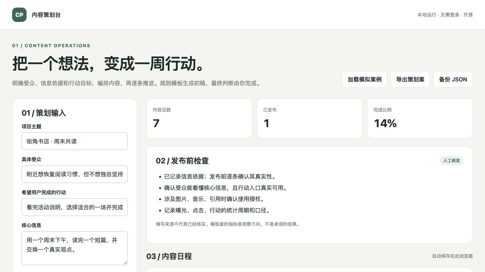

# 内容策划台 · content-plan-studio

把活动主题、受众和行动目标整理为可以执行的内容计划。

**零第三方依赖 · 本地运行 · 中文界面 · MIT**

这是 `hx819-x` 的开源学习作品，初始实现与测试由 Codex 辅助完成。仓库展示可运行的工具和设计取舍，不声称真实商业成果、用户规模或长期维护记录。示例数据和案例均为模拟。

## 产品与运营视角

[产品说明与验收标准](PRODUCT.md)记录了目标用户、需求优先级、设计取舍、待验证指标和下一轮计划。适合结合实际演示说明产品思考。



## 立即运行

下载仓库后直接双击 `index.html`，不需要账号、API key 或安装依赖。文件模式的本地保存行为因浏览器而异；推荐用本地服务获得稳定的同源存储：

```sh
python3 -m http.server 8000 --bind 127.0.0.1
```

然后访问 `http://127.0.0.1:8000`。也可以把仓库根目录作为静态站点部署。页面只读取本地输入，不上传内容；无 CDN、外部字体或统计脚本。

## 功能

- 规则模板生成 7 / 14 天日程，按渠道轮换。
- 编辑标题、负责人、备注和发布状态；自动保存生成后的计划与日程编辑。
- 信息依据提示、进度统计、Markdown 策划案导出。
- JSON 备份 / 恢复，格式校验与损坏草稿回退。

## 三分钟演示

1. 直接打开 `index.html`，查看“街角书店”模拟案例。
2. 修改左侧受众与目标，点击“生成内容计划”。这会替换现有日程，请先备份需要保留的修改。
3. 改一条标题，填写负责人，把状态改为“已发布”。
4. 导出策划案和 JSON，重新打开页面或恢复 JSON，核对修改。

## 可以解释的设计决策

- 核心问题：一份好 brief 至少要说清谁、为什么、做什么以及信息从哪里来。
- 把“希望增长”改成可以观察的行动，而不是预设一定会提升的数值。
- 为什么使用阶段模板而不是随机文案？怎样选择渠道与内容角度？
- 为什么把来源填写和真实性核实分开？

## 限制与口径

这是规则模板工具，不会调用 AI 或自动发布内容。渠道指标是观察建议，不是平台统一标准。左侧 brief 编辑需要点击生成才能应用；生成后的日程编辑自动保存。浏览器本地存储可能被清理，重要计划请导出备份。JSON 只支持本工具导出的完整计划；`sample.json` 是 brief 输入示例，不是恢复备份。

输入内容以 `textContent` / 表单值呈现，不作为 HTML 执行。导入文件限制 1 MB。请不要把真实个人信息、公司数据、账号凭据提交到仓库；本地导出的文件由使用者自行管理。

## 开发与测试

需要 Node.js 20 或更新版本；无需 `npm install`：

```sh
npm test
```

当前包含 **7 项核心逻辑测试**。`core.js` 同时供浏览器和 Node 使用；`app.js` 管理 DOM、文件导出与交互；`style.css` 提供响应式布局；`test.cjs` 验证边界条件与数据口径。

| 文件          | 作用                 |
| ------------- | -------------------- |
| `index.html`  | 可访问的中文页面结构 |
| `core.js`     | 纯逻辑与输入校验     |
| `app.js`      | 界面与导入导出       |
| `test.cjs`    | 自动化测试           |
| `sample.json` | 可复现的模拟输入     |
| `LICENSE`     | MIT 开源许可         |

## 后续改进与贡献

欢迎通过 Issue 提供复现步骤、脱敏示例、预期与实际结果。提交修改前运行测试。建议先增加新的真实使用反馈，再选择功能；不为凑功能数量引入账号、外部 API 或数据收集。

作品集介绍建议写“使用 AI 辅助完成工具原型，并理解、验证其关键逻辑”；能亲自演示和解释后，再具体描述自己完成的修改与贡献。
